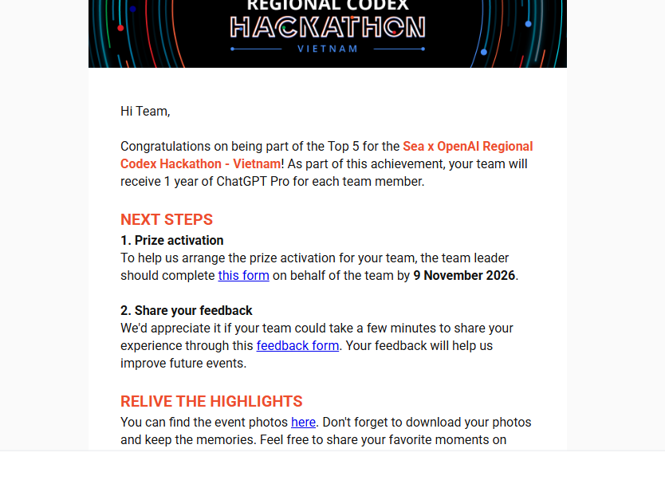

# 🏆 Guardian AI — Top 5 Sea x OpenAI Regional Codex Hackathon – Vietnam

**Đồng hành khi đi một mình. Kết nối hỗ trợ khi cần.**

Guardian AI là ứng dụng web hỗ trợ người đi một mình khi cảm thấy không an toàn. Từ một tín hiệu SOS, hệ thống phối hợp với người thân và điểm hỗ trợ, xác minh lời đồng ý tiếp nhận, đề xuất phương án di chuyển và lưu lại diễn biến sự cố.

## 🏆 Thành tích & thông báo

**Guardian AI lọt Top 5 tại Sea x OpenAI Regional Codex Hackathon – Vietnam.**

Theo thư chúc mừng từ ban tổ chức, đội ngũ Guardian AI được ghi nhận trong **Top 5** của cuộc thi. Phần thưởng dành cho đội là **1 năm ChatGPT Pro cho mỗi thành viên**.

Đây là cột mốc đáng nhớ trong hành trình phát triển Guardian AI. Nhóm xin cảm ơn ban tổ chức Sea x OpenAI và những người đã đồng hành, trải nghiệm và đóng góp ý kiến cho dự án.

<details>
<summary>Xem thông báo từ ban tổ chức</summary>



</details>

## Giới thiệu

Khi một người cần hỗ trợ, việc biết **ai có thể giúp, giúp bằng cách nào và nên đi đâu tiếp theo** là trọng tâm của Guardian AI. Ứng dụng kết hợp hội thoại AI, bản đồ và phản hồi từ mạng lưới hỗ trợ để tạo phương án có người tiếp nhận xác nhận.

AI hỗ trợ giao tiếp, trích xuất thông tin và đề xuất. Backend kiểm tra bằng chứng, điều kiện tiếp nhận và quyền thực thi; người dùng chấp nhận phương án trước khi được hướng dẫn tới điểm hỗ trợ.

> **Trạng thái dự án:** MVP phục vụ phát triển và trình diễn, chưa phải hệ thống cứu hộ được chứng nhận. Địa điểm, người tham gia và tình huống mô phỏng được gắn nhãn trong demo.

## Cách hoạt động

1. **Chuẩn bị mạng lưới:** thêm người thân hoặc đối tác và gửi liên kết mời tham gia.
2. **Gửi SOS:** mô tả nhu cầu bằng văn bản hoặc giọng nói khi đã cấu hình và đồng ý sử dụng AI.
3. **Phối hợp hỗ trợ:** thu thập phản hồi từ nhiều đầu mối, làm rõ khả năng giúp đỡ, điều kiện tiếp nhận và thời gian người thân tự xác nhận.
4. **Đề xuất phương án:** backend lọc các điểm đáp ứng nhu cầu và có lời đồng ý hợp lệ; AI đề xuất trong phạm vi được phép.
5. **Chấp nhận và theo dõi:** người dùng chọn phương án. Khi cam kết bị rút, điều kiện thay đổi hoặc tuyến mất hiệu lực, hệ thống dừng hướng dẫn cũ và yêu cầu chấp nhận phương án mới.
6. **Bàn giao và lưu hồ sơ:** người dùng và nơi tiếp nhận cùng xác nhận hoàn tất; hồ sơ lưu các quyết định, bằng chứng và diễn biến liên quan.

## Tính năng nổi bật

| Tính năng | Nội dung |
| --- | --- |
| Đồng hành bằng AI | Hội thoại và phân tích có cấu trúc qua OpenAI Responses; giọng nói hai chiều qua OpenAI Realtime/WebRTC khi được cấu hình |
| Điều phối mạng lưới hỗ trợ | Người thân và đối tác tham gia bằng liên kết riêng, nhận yêu cầu và phản hồi theo vai trò |
| Bản đồ và tuyến đường | Hiển thị điểm hỗ trợ, so sánh tuyến và đánh giá lại phương án khi điều kiện thay đổi |
| Hẹn giờ chuyến đi | Theo dõi thời gian dự kiến và yêu cầu check-in; hẹn giờ không tự đồng nghĩa với chỉ đường về nhà |
| Hồ sơ sự cố | Lưu transcript, vị trí, phản hồi và lịch sử phương án theo quyền truy cập; chuỗi băm hỗ trợ phát hiện thay đổi nội dung |
| Demo một nút | Đưa lời các vai mô phỏng qua engine điều phối thật để trình diễn xử lý SOS, đổi phương án và bàn giao; không gọi số điện thoại thật |
| Đồng bộ trạng thái | Các màn hình cùng phiên cập nhật qua SSE, có polling dự phòng |
| Ngôn ngữ | Trang giới thiệu và trải nghiệm chính hỗ trợ tiếng Việt/English; bàn điều khiển nâng cao dùng tiếng Việt |

## Bắt đầu nhanh

Yêu cầu **Node.js 24 trở lên** và **npm**. Bản local sử dụng SQLite qua module tích hợp của Node.js.

```sh
git clone https://github.com/Thanh-Mathieu95/GuardianAI.git
cd GuardianAI
npm ci
npm run dev
```

Mở [http://127.0.0.1:3000](http://127.0.0.1:3000).

Để chạy bản build production tại máy:

```sh
npm run build
npm start
```

Trên Windows, có thể dùng `START-GUARDIAN.cmd` để cài dependency và build nếu chưa có, sau đó khởi động server. Khi code thay đổi, cần build lại trước khi chạy `npm start`.

## Trải nghiệm demo

1. Truy cập [bàn điều khiển demo](http://127.0.0.1:3000/demo/command-center) và chọn **Chạy demo**.
2. Theo dõi tình huống SOS, phản hồi từ các bên và phương án trên bản đồ.
3. Quan sát cách hệ thống đánh giá lại phương án khi tình huống thay đổi.
4. Theo dõi bước xác nhận bàn giao, sau đó mở **Hồ sơ** để xem diễn biến và kiểm tra tính toàn vẹn.

Demo mặc định không yêu cầu đăng nhập, microphone hoặc API key. Lời dẫn mặc định tắt và có thể bật trên giao diện. Mô phỏng và thử trên thiết bị là hai luồng riêng; bật AI không biến người hoặc địa điểm mô phỏng thành bên tiếp nhận thật.

### Các màn hình

| Đường dẫn | Mục đích |
| --- | --- |
| `/` | Giới thiệu dự án |
| `/demo/command-center` | Bàn điều khiển đầy đủ: điện thoại AI, bản đồ, hoạt động agent, cuộc gọi và hồ sơ |
| `/demo/phone` | Điện thoại đầy đủ: hội thoại AI, SOS, cuộc gọi giả và đồng hành về nhà |
| `/demo/advanced` | Đường dẫn thay thế tới bàn điều khiển đầy đủ |
| `/demo/guided` | Demo rút gọn với các bước hướng dẫn |
| `/demo/companion` | Giao diện đồng hành rút gọn |
| `/demo/control` | Điều khiển kịch bản, adapter và công cụ kiểm thử |
| `/demo/calls` | Theo dõi cuộc gọi, hội thoại và phản hồi |
| `/demo/architecture` | Kiến trúc và giới hạn hệ thống |
| `/r/<token>` | Liên kết tham gia dành cho người thân hoặc đối tác |

Các tab cùng trình duyệt cần dùng cùng host và cookie để chia sẻ phiên; không trộn `localhost` với `127.0.0.1`. Thiết bị khác tham gia qua liên kết mời đúng vai.

## Cấu hình tích hợp

Sao chép `.env.example` thành `.env.local`, nhập cấu hình tại máy và khởi động lại server. Không đưa khóa thật hoặc `.env.local` lên Git. Demo mô phỏng vẫn dùng được khi AI tắt hoặc không có khóa.

| Biến môi trường | Vai trò |
| --- | --- |
| `AI_PROVIDER` | `OPENAI` để dùng AI khi có khóa; `OFF` để tắt model |
| `OPENAI_API_KEY` | Khóa OpenAI, chỉ dùng phía server |
| `AI_MODEL`, `AI_REALTIME_MODEL` | Model hội thoại/phân tích và model giọng nói |
| `AI_TIMEOUT_MS` | Giới hạn thời gian chờ AI |
| `GUARDIAN_DB_PATH` | Đường dẫn SQLite local; mặc định `./data/guardian.sqlite` |
| `GUARDIAN_RECORDINGS_DIR` | Thư mục ghi âm hoặc cache ghi âm tại backend |
| `GUARDIAN_POSTGRES_URL` | Kết nối PostgreSQL session pooler cho bản host, dùng schema `guardian_ai` |
| `GUARDIAN_SESSION_SECRET` | Khóa phiên ổn định; cũng bảo vệ token người nhận khi lưu trong PostgreSQL |
| `GUARDIAN_SUPABASE_URL`, `GUARDIAN_SUPABASE_SERVICE_KEY` | Cấu hình server cho bucket ghi âm riêng tư |
| `PUBLIC_URL` | Origin HTTPS công khai của bản host |
| `GUARDIAN_DEMO_HOSTING` | Bật nhãn giới hạn hosting cho bản demo; đặt khi build và chạy |
| `GOOGLE_MAPS_API_KEY` | Google Places/Routes khi chọn adapter tương ứng |
| `CALL_GATEWAY_URL`, `CALL_GATEWAY_TOKEN` | Gateway thoại HTTPS tùy chọn do nhóm cung cấp |
| `TEST_CALL_ALLOWLIST` | Danh sách số được phép cho nhánh gọi thử có kiểm soát |
| `OPERATOR_PASSWORD` | Mật khẩu operator tùy chọn |
| `SOS_PER_HOUR` | Hạn mức SOS có thể làm đổ chuông đối tác |

Trên Windows, `SETUP-AI.cmd` hỗ trợ nhập cấu hình AI tại máy. AI cần sự đồng ý trong phiên; API thật có thể phát sinh chi phí.

Microphone và vị trí trên điện thoại cần quyền trình duyệt và ngữ cảnh an toàn, thường là HTTPS. Server mặc định chỉ lắng nghe loopback. `START-TUNNEL.cmd` hỗ trợ thử nghiệm theo [hướng dẫn tích hợp](docs/INTEGRATIONS.md); tunnel phụ thuộc máy đang chạy.

## Công nghệ & kiến trúc

**Next.js 16 · React 19 · TypeScript · Zod 4 · MapLibre/OpenFreeMap · SQLite · PostgreSQL/Supabase**

Backend Node.js giữ engine điều phối, timer giám sát và kênh sự kiện. Bản local mặc định dùng SQLite. Khi cấu hình `GUARDIAN_POSTGRES_URL`, PostgreSQL lưu dữ liệu bền vững; SQLite trong RAM là bộ nhớ làm việc được phục hồi từ database.

| Thành phần | Trách nhiệm |
| --- | --- |
| `app/`, `components/` | Trang và giao diện cho người dùng, người hỗ trợ |
| `app/api/[...path]/route.ts` | HTTP API, phiên, capability và sự kiện |
| `lib/engine.ts`, `lib/types.ts` | Trạng thái sự cố, điều phối và hợp đồng dữ liệu |
| `lib/support.ts`, `lib/coordination.ts` | Điều kiện tiếp nhận, bằng chứng và phân vai |
| `lib/ai.ts`, `lib/realtime.ts` | Tích hợp AI và ngữ cảnh hội thoại |
| `lib/city.ts`, `lib/route-agent.ts` | Đồ thị đường đi, lựa chọn tuyến và đánh giá lại |
| `lib/network.ts`, `lib/receiver.ts` | Mạng lưới hỗ trợ và dữ liệu người nhận được phép xem |
| `lib/store.ts`, `lib/recordings.ts`, `lib/evidence.ts` | Lưu trữ, ghi âm và xuất hồ sơ |
| `lib/database.ts`, `lib/persistent-store.ts`, `lib/runtime-persistence.ts` | Transaction, revision và phục hồi PostgreSQL |
| `lib/remote-recordings.ts`, `supabase/` | Ghi âm riêng tư, migration và chứng chỉ CA công khai |
| `lib/showcase.ts` | Điều khiển demo qua engine |
| `tests/` | Kiểm thử nghiệp vụ, quyền truy cập và API |

Cấu hình hosting được mô tả trong [docs/HOSTING.md](docs/HOSTING.md): **Cloudflare làm điểm truy cập HTTPS → Render chạy Next.js/API → Supabase lưu dữ liệu và ghi âm**. Runtime dùng một tiến trình Node; chưa hỗ trợ autoscaling hoặc job runner nhiều instance. Render Free có thể ngủ hoặc gián đoạn, nên bản demo chưa bảo đảm giám sát liên tục.

## Kiểm tra khi phát triển

Với thay đổi mã nguồn, chạy các kiểm tra phù hợp với phạm vi thay đổi:

```sh
npm run typecheck
npm test
npm run build
```

Thay đổi chỉ tài liệu cần kiểm tra đường dẫn, lệnh và tính nhất quán của nội dung; không cần build ứng dụng.

<details>
<summary>Chạy kiểm thử API trên server QA riêng</summary>

Sau khi build, chạy trong PowerShell:

```powershell
$env:AI_PROVIDER = 'OFF'
$env:GUARDIAN_DB_PATH = ':memory:'
$env:GUARDIAN_RECORDINGS_DIR = Join-Path $env:TEMP ('guardian-qa-' + [guid]::NewGuid())
Remove-Item Env:OPERATOR_PASSWORD, Env:CALL_GATEWAY_URL, Env:CALL_GATEWAY_TOKEN -ErrorAction SilentlyContinue
npm start -- --port 3120
```

Trong terminal thứ hai:

```powershell
$env:GUARDIAN_TEST_URL = 'http://127.0.0.1:3120'
npm run test:api
```

Chỉ chạy với dữ liệu QA. Kết quả mock không xác nhận microphone, WebRTC giữa thiết bị thật, nhà mạng hoặc tích hợp cloud.

</details>

## Dữ liệu & giới hạn vận hành

- Khóa dài hạn ở server. Quyền phiên và người nhận kiểm soát truy cập vị trí, transcript, ghi âm và hồ sơ.
- Bản local không dùng PostgreSQL lưu SQLite và ghi âm tại máy. Bản host có thể lưu dữ liệu trong PostgreSQL và ghi âm trong Supabase Storage riêng tư; hồ sơ không tự hết hạn sau một khoảng thời gian cố định.
- Người nhận cần giữ trang mở để nhận chuông trong ứng dụng. Web chưa bảo đảm cuộc gọi nền như ứng dụng điện thoại native; gọi P2P phụ thuộc mạng và chưa có TURN cho mọi trường hợp.
- Bản đồ và tuyến mô phỏng không xác nhận điều kiện đường hoặc mức an toàn ngoài thực tế.
- Ứng dụng không tự quay số khẩn cấp; liên kết 113/115 để người dùng chủ động mở trình quay số.
- Chuỗi băm hỗ trợ kiểm tra tính toàn vẹn hồ sơ, không chứng minh lời khai là sự thật.
- Khi backend dừng, cuộc gọi đang chạy được đánh dấu gián đoạn, không tự quay số lại. PostgreSQL có khóa để tránh hai backend cùng chạy engine.

## Tài liệu dự án

- [Đặc tả sản phẩm](docs/PROJECT_SPEC.md)
- [Kịch bản demo và giới hạn mô phỏng](docs/AGENT-DEMO.md)
- [Luồng trình diễn](docs/COMPETITION-FLOW.md)
- [Cấu hình tích hợp](docs/INTEGRATIONS.md)
- [Hội thoại AI với người thân và đối tác](docs/AI-MEDIATED-CALLS.md)
- [Agent tuyến và hồ sơ](docs/ROUTE-AGENT-REPORT.md)
- [Kiến trúc Supabase](docs/SUPABASE-ARCHITECTURE.md)
- [Cấu hình hosting](docs/HOSTING.md)
- [Triển khai](docs/DEPLOYMENT.md)
- [Tiêu chí nghiệm thu](docs/ACCEPTANCE.md)
