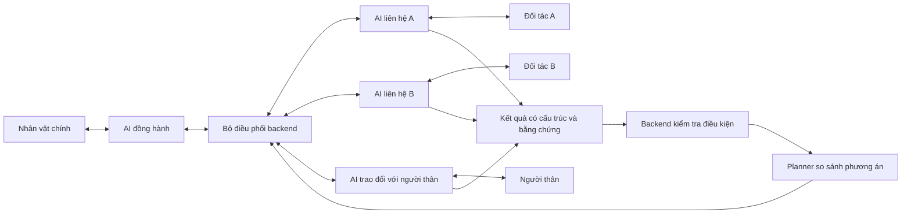

# Hội thoại qua AI và quyết định hỗ trợ nhân vật chính

**Cập nhật 28/10/2026:** đã bổ sung agent tuyến, task GPT so sánh các tuyến có nguồn và lịch sử báo cáo liên tục. Xem [ROUTE-AGENT-REPORT.md](ROUTE-AGENT-REPORT.md) cho phần mới; trạng thái kiểm chứng ở các mục ngày 27/10 bên dưới là lịch sử.

Cập nhật: 27/10/2026. Tài liệu này ghi lại yêu cầu đã làm rõ, thay đổi trong mã nguồn và phần chưa kiểm chứng. Sau lượt chỉ ghi Markdown, người dùng yêu cầu sửa luồng đang chạy vì còn thấy nút nối trực tiếp tới Lan. Đợt tiếp theo đã sửa code, kiểm tra và cập nhật server cổng 3000 như ghi dưới đây.

## Bản sửa luồng nhận cuộc gọi đã cập nhật

- Người thân/đối tác bấm **Trả lời bằng AI** để bắt đầu hội thoại AI riêng khi có cấu hình và phiên đã bật AI. Việc bấm nhận/cấp quyền micro vẫn cần người tham gia thực hiện; không tự mở micro trên thiết bị của họ.
- Đã gỡ tool `connect_to_user` khỏi AI người thân và gỡ handler tự ngắt AI/chuyển sang gọi nhân vật. Prompt yêu cầu giữ hội thoại, hỏi khả năng và gửi tóm tắt cho bộ điều phối qua tool khả năng hỗ trợ.
- **Nói với Guardian AI** là thao tác chính sau khi nhận cuộc gọi; có giải thích AI tổng hợp thông tin cho nhân vật. Khi AI lỗi, hiển thị lỗi/thử lại, không tự chuyển P2P hoặc giả là đã trò chuyện thành công.
- Giữ chức năng P2P có sẵn trong mục thu gọn **Liên lạc trực tiếp (tùy chọn)**. Chỉ người tham gia chủ động mở và bấm mới gọi nhân vật; đây là chức năng liên lạc riêng, không thay thế hội thoại AI.
- Khi chưa cấu hình/bật AI, nút ghi **Nhận thông báo**, không gắn nhãn hội thoại AI thật; có thông báo và đường nhập phản hồi trên màn hình.
- Đã build và khởi động lại server cổng 3000. Đã đối chiếu `/api/health` qua local và tunnel hiện hành: cùng instance. Giữ database và các thành viên sẵn có. Tải lại các trang đang mở để nhận JavaScript mới.

Kiểm tra đợt này: **74/74 tests PASS**, `npm run typecheck`, `npm run build` và `npm run test:api` PASS. API tests chạy trên server kiểm thử riêng cổng 3108, in-memory, AI OFF. Trình duyệt Chrome headless với HTTP/micro giả lập kiểm tra cả người thân và đối tác: nhận cuộc gọi bắt đầu request Realtime, lỗi AI hiển thị đúng, không phát tín hiệu P2P tự động, nút thử lại AI là chính, gọi trực tiếp mặc định thu gọn, mobile không tràn ngang. File QA cục bộ: `data/check-receiver-ai.cjs`; ảnh: `data/receiver-ai-contact.png`, `data/receiver-ai-partner.png`. Chưa xác minh chất lượng hội thoại AI live hay nói thật bằng hai thiết bị.

## Cập nhật tiếp: AI trên máy nhân vật và bản đồ dùng cùng quyết định

Đã nối tiếp luồng **transcript người tham gia → trích xuất/validation backend → lập lại kế hoạch → SSE/poll → AI đồng hành và bản đồ trên máy nhân vật**. Không cần chờ cuộc hội thoại kết thúc; phản hồi được gửi sau từng lượt chép lời. Việc chép lời, kiểm tra và gọi planner có độ trễ và timeout, không phải phản ứng tức thời ở mức âm thanh.

Trước đây AI đồng hành chỉ nhận một số dòng sự kiện, thiếu các loại SUPPORT_UPDATED, FOLLOWUP và PLAN_REEVALUATED; câu tóm tắt cũng không chứa đầy đủ cửa/điều kiện/lý do chọn. Hiện dùng chung phép chiếu `coordinationSummary` cho ngữ cảnh khởi tạo, tool `get_status` và cập nhật đang chạy. Bản tóm tắt gồm từng nhánh, dữ kiện hỗ trợ/bằng chứng, điểm còn thiếu, khả năng người thân, kế hoạch hiện hành, dự phòng, so sánh, nguồn tuyến và bước hướng dẫn được phép đọc. Không mặc định chuyển toàn bộ transcript của các bên hoặc tọa độ chính xác vào bản tóm tắt này.

- AI đồng hành đang mở nhận snapshot mới theo trạng thái SSE/poll; nếu bắt đầu muộn hoặc kết nối lại, nhận snapshot hiện tại. Không phải nối cuộc gọi của đối tác sang máy nhân vật để lấy thông tin.
- Snapshot kế hoạch trong hàng chờ được thay bằng bản mới nhất; không lần lượt đọc lại các điểm đến đã lỗi thời. Khi kế hoạch đã chấp nhận mất hiệu lực, gửi lệnh hủy response/âm thanh cũ nếu người dùng không đang nói, rồi giải thích cập nhật. Lời hứa về cách model diễn đạt vẫn cần đánh giá live.
- Backend quyết định ứng viên hợp lệ và tuyến, AI giải thích bằng lời. Bản đồ đọc chính `plans`/`nav` trong cùng trạng thái; AI không tự vẽ đường hoặc đổi điểm tiếp nhận bằng `get_directions`.
- `AWAITING_ACCEPTANCE`: bản đồ hiển thị phương án mới, AI hỏi chấp nhận; chưa đọc bước đi. `ACTIVE`: đã chấp nhận, hướng dẫn theo tuyến hiện hành. `PAUSED`: dừng chỉ dẫn cũ. Không còn nơi phù hợp thì không có kế hoạch tiếp nhận.
- Tool giọng nói `accept_route` bắt buộc `plan_id` đúng phương án vừa giải thích. Lệnh đồng ý cho kế hoạch cũ bị chặn; không được chấp nhận nhầm phương án mới khi model đang xử lý câu trả lời cũ.
- Tuyến tự do trước SOS vẫn hoạt động với `FREE_WALK`. Khi SOS bắt đầu, tuyến tự do cũ bị gỡ; không được sống lại khi kế hoạch tiếp nhận bị hủy hoặc không có nơi tiếp nhận.
- Đổi thông tin cửa vào không tạo ra tọa độ cửa mới. Nếu chưa có tọa độ cửa có nguồn, cập nhật điều kiện/cách gặp và yêu cầu xác nhận lại; không tuyên bố đường vẽ đã tới đúng cửa đó. Chọn một đối tác khác có tọa độ định tuyến sẽ tạo geometry tuyến tới đối tác đó.
- Người thân nói có thể đi đón được gửi sang AI đồng hành với số phút tự cung cấp. Chưa có điểm đón được xác nhận thì không tự bịa tuyến tới người thân.

Các file chính: `lib/coordination.ts`, `lib/live-updates.ts`, `components/companion.tsx`, `components/client.ts`, `lib/realtime.ts`, `lib/ai.ts`, `lib/engine.ts`, `components/map3d.tsx`, API và `tests/coordination.test.ts`.

Kiểm chứng cập nhật: **78/78 tests PASS**, typecheck và build PASS; HTTP/SSE integration PASS, bổ sung `get_status` có snapshot và chặn tool chấp nhận thiếu/sai plan ID. Chrome headless chạy `data/check-coordination-ui.cjs`: HTTP transcript thật trong server QA → backend → SSE → thông điệp data channel của AI đồng hành. A mơ hồ chưa đủ điều kiện; B xác nhận/được chọn/chấp nhận; A đủ điều kiện không làm đổi tuyến đã chấp nhận; B thu hồi → chọn A với geometry khác, ngắt lời cũ và chờ chấp nhận lại; thời gian đến của người thân cũng tới AI đồng hành. Model/WebRTC/micro giả lập, tất cả request external bị chặn. Ảnh QA: `data/coordination-realtime-map.png`. Đây không phải bằng chứng nghe/nói tiếng Việt bằng model live trên hai thiết bị thật.

Đã cập nhật bản build này vào server 3000, giữ database và thành viên hiện có. Trang command center trả HTTP 200; `/api/health` qua local/tunnel cùng instance. Server QA 3108 đã dừng sau kiểm thử. Tải lại trang để nhận client mới, mở lại AI đồng hành trước khi thử giọng nói.

### Thử trên hai hoặc nhiều máy trong 3–5 phút

1. Dùng cùng URL HTTPS và đúng link Mạng lưới. Chạy phiên **Nhiều máy** trước, rồi mở **Chạm để nói với Guardian** trên máy nhân vật. Bật AI/consent và giữ hội thoại AI đồng hành này đang chạy; mở bảng điều phối không tự bật micro.
2. Bên B chọn **Trả lời bằng AI**, nói rõ quyết định, chỗ chờ, cửa và điều kiện. Nhân vật cần nghe AI đồng hành báo kết quả và lý do chọn B, thấy tuyến đề xuất trên map, rồi chấp nhận bằng giao diện hoặc trả lời rõ với AI.
3. Cho A xác nhận thêm một phương án hợp lệ. Hệ thống giữ B nếu B vẫn hợp lệ và đã chấp nhận, AI biết A là dự phòng.
4. B nói thu hồi hoặc thay đổi điều kiện. AI đồng hành cần thông báo thay đổi; map gỡ hiệu lực tuyến cũ và hiển thị phương án mới nếu có. Nhân vật chấp nhận lại trước khi được hướng dẫn bước đi mới.
5. Thử cả hai không thể tiếp nhận: không còn tuyến tiếp nhận hợp lệ. Thử người thân nói có thể đi đón sau 7 phút rồi đổi thành không thể giúp: AI đồng hành phải nhận trạng thái mới và không giữ ETA cũ.

Reset/chạy kịch bản mới tạo incident mới và kết thúc phiên thoại cũ để bảo toàn cô lập; sau reset cần mở lại AI đồng hành. Với hai máy chỉ thử được nhân vật và một đầu nhận; cần thêm điểm tham gia độc lập hoặc dùng mô phỏng để có nhiều đối tác đồng thời.

## Cơ chế cần đạt

**Mỗi người nói chuyện riêng với AI. AI thu thập, hỏi lại và lọc thông tin; bộ điều phối tổng hợp để đề xuất phương án giúp nhân vật chính.** Nối máy trực tiếp tới nhân vật không phải luồng chính của bản demo này.

Ví dụ: nhân vật chính nói “Tôi cần chỗ chờ kín đáo, không đi vào ngõ”. AI liên hệ đồng thời các đối tác và người thân trong ứng dụng. Đối tác A có thể từ chối; B nói “chắc được” thì AI phải hỏi tiếp; C đồng ý nhưng yêu cầu cửa sau qua ngõ thì backend phải đối chiếu với giới hạn của nhân vật. Không được chọn C chỉ vì đã nói đồng ý.

Các nhánh chạy độc lập, có timeout và giới hạn lượt. Một người không trả lời không được chặn những người khác. Đây là nhiều cuộc hội thoại riêng với AI, không phải phòng họp chung hoặc nhiều tab dùng chung một micro.

## Trách nhiệm và dữ liệu giữa các bước

1. **AI đồng hành** hỏi tình huống và giới hạn của nhân vật; điều chưa được cung cấp giữ là chưa biết. Không mặc định nhân vật có thể đi bộ, nói công khai hoặc đi về nhà.
2. **AI liên hệ từng bên** chỉ nhận thông tin tối thiểu cần thiết và lịch sử nhánh của mình. Hỏi khả năng hỗ trợ, điểm gặp/cửa vào, điều kiện và thời hạn. “Chắc được” chưa phải xác nhận; “chỉ còn 5 phút” cần kiểm tra khả năng đến kịp, không tự tạo ETA.
3. **Trích xuất** lưu quyết định, loại hỗ trợ, cửa vào, điều kiện, thời hạn, thông tin thiếu, thời điểm cập nhật và tham chiếu câu trả lời gốc. Transcript của AI không được dùng thay lời xác nhận của đối tác. Độ tự tin của model không phải bằng chứng đồng ý.
4. **Backend kiểm tra** schema, nhu cầu người dùng, bằng chứng và hiệu lực. Nhánh thiếu thông tin giữ UNKNOWN/CLARIFY; không ép thành ACCEPTED hoặc DECLINED. Hết hạn hoặc thu hồi làm mất hiệu lực phần kế hoạch liên quan.
5. **Planner** chỉ nhận kết quả đã trích xuất và kiểm tra, so sánh phương án hợp lệ theo nhu cầu, hỗ trợ, điều kiện và dữ liệu định tuyến có nguồn. Trả đề xuất, lý do, dự phòng và lý do loại từng ứng viên. Không có nơi hợp lệ thì không tạo kế hoạch tiếp nhận.
6. **AI đồng hành** giải thích ngắn gọn cho nhân vật. Hệ thống tự tổng hợp và đề xuất; nhân vật chấp nhận trước khi thực hiện kế hoạch. Thay đổi đáng kể sau khi đã chấp nhận phải thông báo và yêu cầu xác nhận lại khi phù hợp.
7. **Bàn giao** chỉ hoàn thành khi nhân vật báo đã gặp nhân viên và bên tiếp nhận xác nhận tiếp nhận cho cùng kế hoạch hiện hành. Gần tọa độ không đồng nghĩa đã gặp hoặc đã an toàn.

Người thân cũng trao đổi với AI: có thể giữ liên lạc, có thể đi đón hoặc không thể giúp; thời gian đến chỉ ghi khi họ tự cung cấp. Bộ điều phối và AI đồng hành nhận tóm tắt cần thiết, không mặc định nhận toàn bộ hội thoại.

## Phân biệt các luồng đang tồn tại

| Luồng | Mục đích | Vai trò trong yêu cầu này |
|---|---|---|
| Từng đối tác/người thân ↔ AI | AI hỏi, hiểu và lấy dữ kiện của từng bên | Luồng chính cần trình diễn |
| Nhân vật chính ↔ AI đồng hành | Nhận nhu cầu, giải thích đề xuất, hướng dẫn và cập nhật | Luồng chính cần trình diễn |
| Nhân vật ↔ người thân trực tiếp qua P2P | Liên lạc trực tiếp khi cần | Giữ chức năng sẵn có; không thay thế việc AI thu thập và tổng hợp |
| AI liên hệ ↔ đối tác mô phỏng | Demo một máy, không cần nhiều người hoặc micro | Cùng schema và kiểm tra; phải gắn nhãn mô phỏng/fallback |

Nút nối máy trực tiếp trong giao diện hiện có không chứng minh rằng AI đã hỏi hoặc hiểu đối tác. Phần trình diễn phải cho thấy lời người tham gia, câu hỏi lại của AI, dữ kiện trích xuất và tác động tới quyết định. Giao diện cần làm rõ ai đang nói với AI và ai đang gọi trực tiếp; không chỉ dùng nhãn chung “Nghe/Gọi”. Đây là yêu cầu cần kiểm tra tiếp trên bản chạy thực tế.

## Những thay đổi đã có trong working tree

Các mục dưới đây mô tả mã nguồn hiện hành; trạng thái cập nhật server và phạm vi kiểm chứng xem mục đầu tài liệu.

| Phần | Thay đổi liên quan |
|---|---|
| `components/agent-workbench.tsx`, `components/dashboard.tsx` | Phân biệt demo đối tác mô phỏng với người tham gia trong Mạng lưới; bảng agent thu gọn, xem từng nhánh, transcript, điều kiện và quyết định. |
| `components/receiver.tsx`, `components/client.ts` | Kết nối hội thoại AI riêng, trạng thái micro/AI, báo lỗi HTTPS và cấu hình; xử lý transcript trước khi tool xác nhận có hiệu lực. Luồng P2P cũ vẫn tồn tại. |
| `lib/transcript-queue.ts` | Theo dõi audio item đã commit, chờ bản chép lời và lưu thành công; tránh tool chạy trước bằng chứng, chống trùng trong từng kết nối. |
| `lib/realtime.ts` | Hướng dẫn AI hỏi điều kiện và ghi khả năng người thân, không suy đoán thời gian đến. |
| `lib/engine.ts`, `lib/support.ts` | Phản hồi đối tác đi qua trích xuất/validation và đánh giá lại kế hoạch; chế độ NETWORK dùng nhánh APP; không lấy lời tool tự sinh thay bằng chứng của người nói. |
| `app/api/[...path]/route.ts`, `lib/receiver.ts` | Kiểm tra bật AI/đồng ý, lưu transcript trước khi phản hồi thành công, tách chế độ NETWORK/SIMULATED và trạng thái cấu hình giọng nói. |
| `lib/links.ts`, `components/network-panel.tsx`, `scripts/tunnel.mjs` | Link nhập vai tương đối theo server hiện tại; URL public chỉ được quảng bá sau khi đối chiếu đúng instance; tunnel ghi metadata theo cổng đích. |
| `tests/multi-device.test.ts` | Mock transport kiểm tra cách ly nhánh, bằng chứng đến muộn, link khác server và việc nội dung phản hồi thay đổi lựa chọn. |

### Nguyên nhân link nhập vai không vào được đã tìm thấy

Ở thời điểm chẩn đoán, bản xem trước cổng `3108` dùng database in-memory và AI tắt; tunnel lại trỏ tới server `3000`. Một token thử nghiệm trả HTTP 200 ở `3108` nhưng 404 ở `3000` và URL tunnel. Link đã đưa người tham gia sang backend khác với nơi tạo token.

Đã bổ sung kiểm tra instance trong mã nguồn và chuyển metadata tunnel sang JSON, giữ bản sao metadata cũ. Đợt sửa tiếp theo đã build/restart server 3000 và xác nhận local/tunnel cùng instance. Không dùng token tạo ở bản xem trước để thử trên server chính. Không xóa database hoặc thành viên để xử lý lỗi này.

## Cách thử đúng luồng sau khi cập nhật bản chạy

Đây là hướng dẫn cho lần triển khai/kiểm tra tiếp theo, chưa phải biên bản đã thử thành công.

1. Chạy tests, typecheck và build; khởi động lại server đúng database/cấu hình khi không có cuộc hội thoại đang diễn ra. Dùng một backend thống nhất, ví dụ cổng `3000`. Nếu cần tunnel: `node scripts/tunnel.mjs 3000`. Dùng URL HTTPS mới và link thành viên do chính backend đó tạo; điện thoại không dùng `localhost` của máy tính.
2. Chủ phiên bật AI và đồng ý sử dụng theo giao diện hiện có. Thêm đối tác/người thân trong **Mạng lưới**, gửi mỗi người link riêng; họ đồng ý tham gia và sẵn sàng nhận liên hệ. Không chia sẻ API key.
3. Mở **Hoạt động agent → Chi tiết → Kịch bản → Người tham gia → Nhiều máy · người trong mạng lưới**. Nhập nhu cầu và chạy. Từng bên cần vào hội thoại AI riêng. Nếu chỉ có nút/kết quả nối thẳng tới nhân vật, chưa đạt bài thử này.
4. Cho A nói “Tôi không thể nhận”; B nói “Chắc được” rồi chờ AI hỏi lại; C nói rõ loại hỗ trợ, cửa và điều kiện. Không bấm xác nhận thay cho lời nói khi đang đánh giá cơ chế hiểu hội thoại. Mỗi người cần thiết bị/micro độc lập hoặc tai nghe để tránh âm thanh nhánh này lọt vào nhánh khác.
5. Xem transcript và dữ kiện trích xuất. B phải còn chưa đủ điều kiện trước khi làm rõ. Thay câu trả lời hoặc điều kiện phải có khả năng thay đổi ứng viên hợp lệ và đề xuất. Xem lý do lựa chọn, rồi để nhân vật chấp nhận.
6. Cho bên được chọn đổi cửa hoặc thu hồi. Hệ thống phải đánh giá lại, thông báo nhân vật và không tiếp tục dẫn theo kế hoạch cũ. Thử người thân đổi khả năng, rồi xác nhận bàn giao hai phía.

Hai máy có thể thử nhân vật chính và một người tham gia từ xa. Để chứng minh nhiều người nói đồng thời với AI, cần thêm các điểm tham gia độc lập; nhiều tab dùng chung một micro không chứng minh được điều này. Chế độ mô phỏng phù hợp khi chỉ có một người trình diễn, nhưng không được ghi nhận là kiểm chứng giọng nói nhiều máy.

## Trạng thái kiểm chứng

| Hạng mục | Trạng thái đã ghi nhận |
|---|---|
| `npm test` sau các thay đổi nhiều máy, AI đồng hành và bản đồ | 78/78 PASS; mock transport, không phải đánh giá chất lượng AI live. |
| Typecheck | PASS cho đợt sửa luồng AI hiện tại. |
| Build, HTTP/SSE và UI desktop/mobile của đợt trước | Đã PASS cho phiên bản trước sửa link/voice mới nhất; không dùng làm bằng chứng cho bản mới nhất. |
| Build và API cho sửa link/voice, UI người nhận | PASS; API chạy ở môi trường riêng, UI dùng HTTP/micro giả lập, xem chi tiết đầu tài liệu. |
| Triển khai sửa đổi mới vào server đang chạy | Đã build/restart cổng 3000, kiểm tra health local/tunnel cùng instance. |
| Nhiều máy nói thật với AI, hỏi lại và chọn phương án qua giọng nói | Chưa kiểm chứng live. |
| Cuộc gọi P2P trực tiếp xuyên các mạng khác nhau | Chưa kiểm chứng; đường hiện có dùng STUN, chưa có TURN để xác nhận hoạt động trên các NAT/firewall khó. |

Ưu tiên tiếp theo khi quay lại triển khai là hoàn tất vòng **người tham gia → AI hỏi lại → transcript gốc → trích xuất → backend kiểm tra → planner → AI giải thích cho nhân vật**, rồi kiểm thử trên nhiều thiết bị. Không coi kết nối âm thanh hoặc nối máy trực tiếp thành công là đã hoàn thành vòng quyết định này.

Tham khảo kỹ thuật: [OpenAI Realtime WebRTC](https://developers.openai.com/api/docs/guides/voice-webrtc) và [Realtime conversations](https://developers.openai.com/api/docs/guides/realtime-conversations). Đây là tài liệu thiết kế, không phải bằng chứng đã thử live. Kịch bản demo một máy: [AGENT-DEMO.md](AGENT-DEMO.md).
