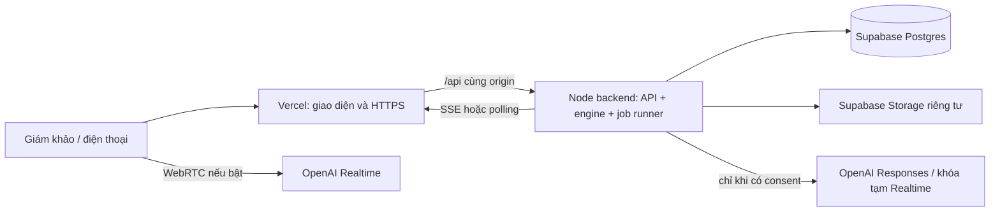

# Guardian AI — luồng sản phẩm và demo nộp thi

## Phạm vi bản thiết kế

Đây là thiết kế đích để phát triển từ code hiện tại; các màn hình/hợp đồng mới chưa được coi là đã triển khai. Nhóm đã chọn Vercel và Supabase, đã có API key và giao quyền tự thiết kế luồng. Ưu tiên một bản demo ổn định, giám khảo tự khám phá được và chứng minh rõ năng lực điều phối có bằng chứng.

Thông điệp: **Một lời cầu cứu → nhiều lời đề nghị → một phương án có người nhận → tự điều chỉnh khi cam kết thay đổi → một hồ sơ truy vết được.** Không lấy việc chạy nhiều model hay nhiều agent làm kết quả thay cho trợ giúp cụ thể.

## 1. Hai cách trải nghiệm, một engine

| Chế độ | Ai dùng | Nội dung | Điều kiện |
|---|---|---|---|
| Xem tình huống, mặc định | Giám khảo mở link | Demo tự chạy khoảng 2–3 phút; vai người dùng/đối tác/người thân mô phỏng; điều phối bằng engine thật | Không đăng nhập, không micro, không key riêng, không gọi số thật |
| Thử tương tác | Giám khảo muốn đào sâu hoặc nhóm trình diễn | Gõ lời cầu cứu hoặc bật giọng nói; thử thu hồi cam kết, đường tối, thay đổi nhu cầu | AI thật do server nhóm cung cấp, consent và quota; có đường text/offline |

“Mô phỏng” mô tả nguồn dữ liệu/vai diễn; “AI thật” mô tả việc đã có kết quả model hợp lệ. Hai nhãn độc lập: bật model không biến địa điểm hoặc cuộc gọi mô phỏng thành thật. Nếu AI lỗi, hiện fallback và tiếp tục qua rule engine khi đủ dữ kiện.

Không bắt giám khảo chọn model, nhập key, tạo mạng lưới hay cấp micro ngay khi mở link. Không tự phát tiếng; người xem bật lời dẫn bằng thao tác rõ ràng.

## 2. Hành trình từ link nộp

1. **Landing `/`:** thông điệp một câu, hình thật của sản phẩm, nhãn demo và CTA chính “Chạy tình huống mô phỏng”. CTA phụ “Tự trải nghiệm”. Phần dưới giải thích ai giúp, ai quyết định, bằng chứng ở đâu và giới hạn của demo.
2. **Chuẩn bị demo:** trong command center, server kiểm tra backend/persistence/scenario; tạo phiên riêng và trả trạng thái sẵn sàng. Nếu chưa sẵn sàng, có lý do ngắn và nút thử lại, không giả chạy bằng video.
3. **Bắt đầu:** một nút chạy; mặc định im tiếng + phụ đề, tùy chọn bật lời dẫn. Giữ các nút tạm dừng, tiếp tục, chạy lại và xem hồ sơ dễ tìm.
4. **Chứng kiến thay đổi:** camera focus đúng dữ kiện từng chặng; cập nhật bản đồ, transcript, biên bản và lời dẫn cùng revision từ backend.
5. **Kết thúc:** mở hồ sơ ngay trong luồng, xem một quote gốc → quyết định tương ứng → phiên bản tuyến → hash/niêm phong. Có nút chạy lại phiên mới.
6. **Đào sâu:** thử một thay đổi có hướng dẫn hoặc mở app điện thoại. Chế độ nhiều thiết bị là nhánh phụ, không là điều kiện để hiểu hoặc hoàn thành demo.

## 3. Kịch bản chính khoảng 150 giây

Thời lượng dưới đây là ngân sách trình bày, không phải thời gian được bảo đảm trước khi đo bản triển khai. Không tăng tốc bằng bỏ validation hoặc viết sẵn kết quả.

| Chặng | Ngân sách | Đầu vào từ vai/kịch bản | Engine phải chứng minh | Người xem cần nhận ra |
|---|---:|---|---|---|
| Bối cảnh | 10 s | 22:15, Lan đi một mình và bị bám theo | Vị trí/địa điểm/rủi ro có nhãn mô phỏng | Đây là một tình huống cụ thể |
| SOS và nhu cầu | 12 s | Cần chỗ chờ, nước uống, tránh hẻm | Ghi nhu cầu, lọc giờ/chức năng, không chọn theo khoảng cách đơn thuần | Hệ thống hiểu ràng buộc |
| Liên hệ đồng thời | 18 s | Tối đa 3 đối tác và 2 người thân | Các nhánh độc lập, timeout, không nhầm nghe máy với nhận giúp | Một người cầu cứu, nhiều người cùng góp sức |
| Mỗi người một ý | 18 s | Có nơi chỉ có cửa sau; có nơi nói mơ hồ; người thân hẹn 10 phút hoặc giữ máy | Quote đúng người; hỏi gộp một lần khi cần; ETA có nguồn | Lời hứa có thể kiểm tra |
| Kế hoạch đầu tiên | 18 s | Các lời đáp đã xử lý | Admission → planner → PRIMARY/SUPPORT/BACKUP/UNUSED; lý do loại | AI tổng hợp chứ không chỉ hiển thị danh sách |
| Chấp nhận và đi | 12 s | Vai người dùng đồng ý | Đúng plan/revision; tuyến và chỉ dẫn cùng trạng thái | Người dùng kiểm soát phương án |
| Rút cam kết | 18 s | Đối tác được chọn báo nhân viên đã đi | Hủy kế hoạch cũ, dừng chỉ dẫn, chọn lại, xin chấp nhận lại và đổi điểm hẹn | Khác biệt rõ nhất của Guardian AI |
| Đoạn đường tối | 14 s | Người dùng báo đoạn phía trước thiếu sáng | Tính lại geometry hợp lệ và giải thích, không đổi màu một đường cũ | Tình huống thay đổi thì hành động thay đổi |
| Khẩn cấp/mất liên lạc | 18 s | Vai mô phỏng báo bị thương rồi mất tín hiệu | Quy tắc khẩn cấp; vị trí cuối; niêm phong/chia sẻ; chỉ mở tel để người dùng tự gọi | Hệ thống giữ được dấu vết khi liên lạc gián đoạn |
| Hồ sơ và kết | 12 s | Người xem mở hồ sơ | Timeline/quote/plan history/hash/nhãn demo thống nhất | Quyết định có thể truy vết sau sự cố |

Đường kết thúc chính là nhánh mất liên lạc và hồ sơ, không ghi “đã an toàn” hay giả bàn giao thành công. Bàn giao hai chiều là một kịch bản phụ riêng. Sự kiện mất liên lạc tăng tốc trong demo phải do đồng hồ/fixture mô phỏng có nhãn; không đổi ngưỡng an toàn live để chạy nhanh.

Kịch bản hiện có trong `lib/showcase.ts` là điểm bắt đầu. Khi điều chỉnh, giữ đạo diễn chỉ cấp lời của các vai và sự kiện môi trường; mỗi mốc phải assert trạng thái thật. Nếu thiếu nơi đủ điều kiện hoặc kết quả không đạt mốc, dừng với lý do và cho chạy lại, không cưỡng ép người thắng.

## 4. Bố cục và nhịp thông tin

Theo Impeccable và DESIGN hiện tại: landing Persuade, command center/phone/receiver Operate, hồ sơ Read. Nhận diện “Biên bản niêm phong”: giấy sáng, mực xanh, quote có nguồn, dấu đỏ cho xác nhận/khẩn cấp; điện thoại dùng biến thể ban đêm. Giữ hành vi và ngữ nghĩa nguồn dữ liệu khi đổi trình bày.

- **Command center:** một dòng chặng + một câu diễn giải; bản đồ là trọng tâm. Hai vùng cạnh cho điện thoại và biên bản ai làm gì. Transcript đầy đủ/lịch sử model nằm trong phần mở rộng.
- **Biên bản:** ai, giúp gì, ở đâu, khi nào, trạng thái, quote. Cam kết bị rút hiện dấu gạch và thời điểm; phương án mới không xóa lịch sử cũ.
- **Phone:** một chỉ dẫn tiếp theo, một nơi đến, lý do ngắn và nút chấp nhận. Thiếu GPS/micro có đường text/vị trí mô phỏng rõ ràng.
- **Receiver:** tham gia/nghe/trả lời, phần việc được giao và trạng thái chia sẻ hồ sơ đúng quyền. Đối tác chưa đồng ý không thấy vị trí chính xác.
- **Hồ sơ:** tóm tắt một đoạn, timeline, lời khai, đường đi, người hỗ trợ/quote, quyết định, recording và kiểm tra chuỗi băm; phụ lục kỹ thuật thu gọn.

Không tự đổi nhận diện sang giao diện neon. Không dùng màu làm tín hiệu duy nhất, không ép motion, không che chỉ dẫn khi toast xuất hiện. Kiểm tra 390 px, desktop 1440 px và màn hình trình chiếu.

## 5. Trạng thái lỗi và hành động phục hồi

| Tình huống | Hành vi đích |
|---|---|
| Backend chưa sẵn sàng | Nêu đang chuẩn bị/lỗi kết nối và nút thử lại; không tạo incident trùng |
| Supabase lỗi ghi | Không xác nhận đã lưu/niêm phong; giữ retry hữu hạn và báo gián đoạn |
| Model chậm/hết quota | Hủy theo timeout, hiện fallback có nhãn; không xóa cam kết hợp lệ |
| Không nơi nào đủ điều kiện | Không có tuyến tiếp nhận; báo đúng, tiếp tục cập nhật người thân và lựa chọn người dùng |
| SSE mất | Polling/resume theo cursor; không phát lại side effect |
| Browser refresh | Phục hồi phiên từ server; client không tự tạo demo thứ hai |
| Backend restart | Nạp checkpoint/job; đánh dấu công việc gián đoạn, không tự gọi lại số thật |
| Lời dẫn bị chặn | Phụ đề vẫn chạy; watchdog có thông báo; không treo chặng |
| Token hết hạn/sai vai | Từ chối gọn; không lộ sự tồn tại hay hồ sơ incident khác |
| Giám khảo chạy lại | Incident/generation mới; callback phiên trước không đổi phiên sau |

## 6. Kiến trúc phục vụ luồng

Mặc định Node backend triển khai một instance trên Render để giảm phạm vi chuyển engine. Không chạy engine thứ hai trên Vercel. Supabase là nguồn persistence; SQLite chỉ còn adapter local/test sau migration. Không dùng Supabase Edge Functions làm ticker vô hạn. Chi tiết trong `SUPABASE-ARCHITECTURE.md`.

## 7. Các mốc triển khai và điều kiện qua cổng

| Mốc | Kết quả cần giao | Điều kiện qua |
|---|---|---|
| M0 — hợp đồng | Tài liệu này, AGENTS, kiến trúc, thiết kế hiện có | Không mâu thuẫn luồng/nguồn dữ liệu/ai quyết định |
| M1 — persistence | Adapter Postgres async, transaction event/hash, session secret ổn định | Lưu/đọc/cô lập/restart/concurrent update; không gọi remote bằng API sync |
| M2 — nền và file | Job/deadline/checkpoint; private Storage và upload chunk | Generation/idempotency/lease, quyền tải, hash, retry và phục hồi |
| M3 — đường deploy | Backend health/readiness, Vercel proxy, origin/cookie/URL đúng môi trường | Smoke/API integration trên hạ tầng thử; tách Preview/Production |
| M4 — trải nghiệm | Entry một nút, storyboard và màn kết, lỗi/thử lại | Demo trọn, UI không lỗi, ảnh đã xem, Impeccable audit/critique |
| M5 — AI live phụ | Key server, consent, hạn mức, thử micro/thiết bị | Không key ở client, không lặp tool, không giả live khi fallback |
| M6 — bản nộp | Production URL, hướng dẫn, giới hạn, release/rollback | Thử ngoài tài khoản nhóm, nhiều phiên, không phụ thuộc laptop |

Chưa qua M1–M3 thì không ghi “đã deploy thành công” chỉ vì landing tải được. Có API key không thay thế việc cấu hình, migration, quyền storage hoặc kiểm tra môi trường thật.

## 8. Kịch bản thử phụ và số liệu

Giữ các bài: tất cả nơi từ chối; người dùng chỉ đi được 100 m; đối tác tắt trực; không qua hẻm; transcript người thân rác; tab reload; nhiều giám khảo đồng thời; bàn giao hai chiều. Mỗi bài trả kết quả quan sát được và event/evidenceRef, không chấm theo độ hay của lời AI.

Đo từ event thật: thời gian SOS → phương án đủ điều kiện; số nhánh; thời gian thu hồi → dừng tuyến cũ; số revision; số cam kết có quote; hoàn tất ghi/chia sẻ hồ sơ; tỷ lệ demo hoàn thành. Không điền sẵn số đẹp hoặc tuyên bố hiệu quả ngoài môi trường demo.
