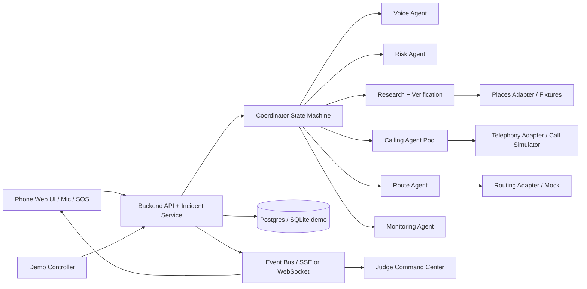

# GUARDIAN AI — FULL PROJECT SPECIFICATION & HACKATHON DEMO BLUEPRINT

> Version: 1.0 | Ngôn ngữ: Tiếng Việt | Mục tiêu: MVP hackathon 10 phút, web-first, có đường nâng cấp production.
>
> **Cảnh báo:** Đây là công cụ hỗ trợ, không phải hệ thống cứu hộ được chứng nhận. Trong demo không gọi 113, không gọi cửa hàng ngẫu nhiên, không tuyên bố AI có thể xác định chắc chắn nguy hiểm hoặc nơi trú ẩn an toàn.

## 0. Tuyên bố sản phẩm

**Guardian AI** là hệ thống bảo vệ người đi một mình, đặc biệt vào ban đêm, sử dụng **Voice AI + Multi-Agent orchestration** để tiếp nhận SOS, tìm điểm hỗ trợ dựa trên vị trí, xác minh thông tin công khai, liên hệ nhiều đầu mối được phép song song, gợi ý đường đi và **lập kế hoạch lại** khi tình huống thay đổi.

**Thông điệp demo:** “Một lời cầu cứu → một nhiệm vụ cứu trợ phối hợp, minh bạch và có thể kiểm soát.”

### Phân biệt giá trị với ứng dụng SOS

- SOS truyền thống: phát tín hiệu, gửi tọa độ hoặc gọi một liên hệ.
- Guardian: phân phối nhiệm vụ giữa các agent, tìm và kiểm chứng nhiều phương án, thu thập kết quả cuộc gọi, lựa chọn địa điểm **đã đồng ý hỗ trợ**, đề xuất tuyến đi và thay đổi kế hoạch khi thất bại.
- Không khẳng định độc quyền ý tưởng hoặc thay thế cảnh sát. Giá trị mới phải được chứng minh bằng demo và đánh giá.

## 1. Người dùng, bài toán và phạm vi

**Người dùng:** nhân viên về khuya, sinh viên, người chạy xe/đi bộ một mình, lao động ca đêm; nhà trường/doanh nghiệp triển khai chương trình an toàn (về sau).

**Vấn đề:** người dùng khó thao tác điện thoại khi hoảng sợ; không biết địa điểm nào có người hỗ trợ; khó gọi từng đầu mối; thông tin phân tán; phải tính lại kế hoạch khi bị từ chối hoặc đường không đi được.

### Thành công của MVP

1. Người dùng nói lời SOS bằng microphone trên trang web; có nút SOS và ô nhập text dự phòng.
2. Một incident được tạo, có ID, thời gian, vị trí mô phỏng và mức độ/căn cứ rõ ràng.
3. Research Agent thực hiện tìm địa điểm qua adapter dữ liệu (API thật nếu có khóa; fixture dự phòng) và cho biết **nguồn + thời điểm lấy + trạng thái xác minh**.
4. Calling Agents thực hiện **cuộc gọi song song đến các số thử nghiệm thuộc nhóm** (nếu nhà cung cấp viễn thông cho phép); luôn có call simulator fallback.
5. Coordinator chọn địa điểm có xác nhận, Route Agent vẽ đường và hướng dẫn bằng text/voice.
6. Giám khảo bấm “Đường bị chặn”, “Điểm hỗ trợ từ chối”, “Mất GPS” → hệ thống cập nhật phương án thực sự.
7. Dashboard và màn hình điện thoại đồng bộ, log mọi lần đổi quyết định.

**Ngoài phạm vi MVP:** tự động gọi số khẩn cấp thật; camera giám sát công cộng; tự suy đoán có người bám theo chỉ từ GPS; giám sát vị trí khi web đã bị trình duyệt đình chỉ chạy nền; tự động gọi số công khai hàng loạt mà không có thỏa thuận/đồng ý phù hợp.

## 2. Chiến lược demo: MỘT WEB, HAI GÓC NHÌN, MỘT CONTROL PANEL

### Chế độ

- **Demo Mode (mặc định trên sân khấu):** GPS scenario seed, tình huống nhân tạo, dữ liệu địa điểm seed có nguồn/nhãn, gọi số thử nghiệm hoặc mô phỏng, không gửi thông báo cứu hộ thật. Banner **SIMULATION** liên tục trên mọi màn hình.
- **Live Tech Mode:** microphone, speech-to-text/voice realtime, Places API live, routing API live, cuộc gọi thực **chỉ đến số test allowlist do nhóm kiểm soát**. Mọi tác động external phải nêu rõ trên UI.
- **Future Real Safety Mode (không bật trong hackathon):** yêu cầu xác minh pháp lý, tiêu chuẩn vận hành, thỏa thuận điểm hỗ trợ, đánh giá an toàn, review con người và tích hợp dịch vụ khẩn cấp.

### Bố cục sân khấu đề nghị: `/demo/command-center` 16:9

- **Top bar** (8% cao): logo GUARDIAN AI, `INC-2026-DEMO-001`, đồng hồ incident, chế độ SIMULATION/TEST CALL, thông số GPS `mock`, trạng thái mạng, nút reset.
- **Cột trái 25–28%**: **Phone Simulator** tỷ lệ 9:19.5; bên trong có Voice waveform, lời người dùng, lời AI, SOS, card “đang đến điểm hỗ trợ”, ETA *chỉ khi routing API trả về*, biểu tượng vị trí và nút Help. Không tự chế ETA.
- **Cột giữa 42–45%**: **Live Map** lớn, marker người dùng, marker các điểm ứng viên, đường đi được chọn, đường bị chặn giả lập, phương án A/B; overlay xác nhận điểm tiếp nhận.
- **Cột phải 27–30%**: **Agent Operations** dạng tabs/tầng: 6 agent trạng thái IDLE/WORKING/WAITING/SUCCEEDED/FAILED, Call Matrix (3 liên hệ), Decision Panel (tại sao chọn phương án này), Incident Timeline.
- **Bottom ribbon** (12–16% cao): **Event feed** chữ lớn trên máy chiếu: `23:45:21 • HOTEL B CONFIRMED • ROUTE B SELECTED`; timeline chạy theo sự kiện; controls mini chỉ người trình diễn dùng.

#### Wireframe desktop 1920×1080 (không phải pixel-perfect)

```text
┌──────────────────────────────────────────────────────────────────────────────────────────────┐
│ GUARDIAN AI     INCIDENT #001       ● SIMULATION        GPS: MOCK     02:34 elapsed  RESET   │
├──────────────────────┬────────────────────────────────────────────┬──────────────────────────┤
│ PHONE SIMULATOR      │ LIVE INCIDENT MAP                          │ AGENT OPERATIONS         │
│ ┌──────────────────┐ │                                            │ Risk     ✓ triaged       │
│ │ 23:45   ◉ SOS    │ │     [Store A] x                            │ Research ✓ 3 candidates  │
│ │                  │ │    ⋯⋯ ⋯ blocked route                      │ Police   ready*          │
│ │ 'Tôi đang...'    │ │             ● USER ═══════> [Hotel B] ✓   │ Call A   ✕ declined     │
│ │ GUARDIAN:        │ │                   \\                         │ Call B   ✓ confirmed    │
│ │ 'Đến khách sạn B'│ │                    [Pharmacy C] ?          │ Call C   no answer      │
│ │ [LIVE TRANSCRIPT]│ │                                            │ Route    ● replanning   │
│ │ [SOS][MUTE]      │ │ [candidate cards + SOURCE + VERIFIED TAG] │ COORDINATOR DECISION     │
│ └──────────────────┘ │                                            │ Hotel B chosen, reasons │
├──────────────────────┴────────────────────────────────────────────┴──────────────────────────┤
│ 23:45:24  HOTEL B ACCEPTED  →  PLAN UPDATED  →  REROUTING  | Inject: BLOCK ROAD / REJECT    │
└──────────────────────────────────────────────────────────────────────────────────────────────┘
```

### Khả năng đọc trên máy chiếu

- Font toàn trang Inter/Arial; tiêu đề >=28px, nhãn cột >=20px, log cốt lõi >=18px trên viewport 1920; thông tin phụ không nhỏ hơn 15px nếu dùng để thuyết trình.
- Chế độ **Presentation** ẩn dev controls và gom log thành câu rõ nghĩa; nút `Spotlight` phóng lớn panel Voice / Calls / Decision khi thuyết trình.
- Giới hạn 3–5 dòng sự kiện quan trọng cùng lúc; scroll log chi tiết chỉ nằm trong tab Advanced.
- Tương phản cao, không phân biệt trạng thái chỉ bằng màu, có biểu tượng và chữ (`ACCEPTED`, `DECLINED`).
- Trạng thái cuộc gọi **RINGING**, **CONNECTED**, **DECLINED**, **TIMEOUT**, **CONFIRMED** là các trạng thái khác nhau.

### Trang bổ sung

| Route | Đối tượng | Nội dung | Vai trò demo |
|---|---|---|---|
| `/demo/command-center` | Máy chiếu/giám khảo | Bảng tổng hợp tất cả thành phần | Màn hình chính |
| `/demo/phone` | Điện thoại thật hoặc iframe | Voice AI, SOS, đường đi, transcript | Màn hình người dùng |
| `/demo/control` | Laptop phụ/ẩn | Nút đưa sự kiện bất ngờ, reset, chế độ gọi | Người trình diễn điều khiển |
| `/demo/calls` | Khi spotlight | Trạng thái 3 cuộc gọi, transcript, phản hồi | Minh chứng parallel calling |
| `/demo/architecture` | Backup | Kiến trúc Agent + kỹ thuật + safety | Q&A |

**Đồng bộ:** tất cả trang subscribe cùng incident qua WebSocket/SSE; không hard-code màn hình chiếu bằng animation giả tách khỏi backend.

## 3. Hành trình người dùng và state machine

`IDLE → ACTIVE_TRIP → SOS_RECEIVED → TRIAGE → SEARCHING → CONTACTING → ROUTE_PROPOSED → GUIDING → HELP_REACHED → CLOSED`

Các nhánh: `REPLANNING`, `AWAITING_CONFIRMATION`, `NO_RESPONDERS`, `LOCATION_UNAVAILABLE`, `USER_CANCELLED`, `ESCALATION_OFFERED`.

### Quy tắc an toàn

- Người dùng bấm SOS hoặc nói mật mã đã đặt → bắt đầu incident theo thiết lập.
- Tín hiệu mơ hồ → hỏi xác nhận ngắn thay vì khẳng định bị tấn công.
- Nếu khẩn cấp, UI cho gọi cơ quan chức năng và chia sẻ thông tin cần thiết; demo tuyệt đối không gọi số thật.
- Các quyết định định tuyến là gợi ý; người dùng có thể từ chối, yêu cầu dừng, chỉnh địa điểm.
- Không lộ vị trí chính xác cho điểm chưa xác nhận nếu không cần thiết/chưa được cho phép.
- Nếu mất kết nối, UI hiển thị mức độ dữ liệu đã cũ (`Last seen at ...`), không giả vờ cập nhật GPS.

## 4. Agent contracts

### 4.1 Voice Agent

**Input:** microphone stream hoặc text fallback, locale VI, incident state. **Output:** transcript có timestamp, intent (SOS, ask-help, route-obstacle, cancel), câu trả lời ngắn. **Guardrail:** không hứa “cảnh sát đang đến” nếu chưa có xác nhận thật; hỗ trợ voice replay từ file test nhưng phải gắn `REPLAY`.

### 4.2 Risk Agent

**Input:** lời người dùng, cảnh báo, vị trí và freshness. **Output:** `risk_level`, `confidence`, `reasons`, `unknowns`, `next_action`. **Guardrail:** không suy ra có tội phạm chỉ dựa vào quãng đường hoặc âm sắc giọng; ưu tiên mức hỗ trợ do người dùng yêu cầu.

### 4.3 Research Agent

**Input:** lat/lng giả lập hoặc live có đồng ý, bán kính, `open_now` khi API hỗ trợ, category. **Sources:** Places/Maps chính thức, website doanh nghiệp được phép truy cập, OSM. **Output:** `PlaceCandidate[]` gồm `place_id`, name, address, phone (nếu hợp pháp và được phép sử dụng), source, captured_at, opening_hours_status, contact_policy, confidence, `verified_support=false` mặc định. Không tạo số giả để gọi ra ngoài.

### 4.4 Verification Agent

Xác minh số, giờ mở cửa, nguồn/độ mới; đánh dấu `PUBLIC_INFO_ONLY`, `CONTACT_ATTEMPTED`, `SUPPORT_CONFIRMED`; không biến việc có số điện thoại thành quyền gọi khẩn cấp vô hạn.

### 4.5 Calling Agent Pool

**Input:** số test allowlist/đối tác opt-in, mẫu câu hỗ trợ, giới hạn tần suất. **Output:** call_id, status, transcript, support decision, human-confirmed status. Song song tối đa 3 cho demo, timeout cấu hình, retry có giới hạn. **BẮT BUỘC:** AI nói rõ là AI, lý do cuộc gọi, không đưa thông tin nhạy cảm thừa, cho phép kết thúc; chỉ quay số thật đến số do nhóm kiểm soát hoặc đối tác đã đồng ý.

### 4.6 Route Agent

**Input:** user location, verified candidate, route constraints, blocked-segment. **Output:** `RouteOption[]`, selected route, route-source, estimated duration nếu API có, notes. Không mặc định “đường an toàn nhất” từ dữ liệu map chung; gọi là “tuyến phù hợp/được lựa chọn”, hiển thị giới hạn.

### 4.7 Contact/Police Agent

Đối với người thân: gửi mẫu thông tin theo consent có thể chỉnh sửa. Với cảnh sát: cung cấp nút gọi số khẩn cấp và chuẩn bị tóm tắt **được xác minh**; gọi/trao đổi tự động với cơ quan công quyền thực tế **không có trong demo**.

### 4.8 Coordinator + Monitoring Agent

Coordinator duy trì kế hoạch, phân công tasks, quyết định dựa trên dữ liệu thật và guardrails. Monitoring cập nhật status, thời hạn, failure, nhận event và kích hoạt replanning; tránh infinite tool loops. Mọi hành động cần `reason_code` và `evidence_refs` hiển thị trên dashboard.

## 5. Cách Agent gọi và phản hồi

### Conversation scripts ngắn (cuộc gọi với số test đã đồng ý)

**AI:** “Xin chào, tôi là trợ lý AI Guardian trong một buổi thử nghiệm được phép. Có một người cần tìm chỗ chờ hỗ trợ gần khu vực của anh/chị. Hiện có nhân viên trực và anh/chị có thể tiếp nhận không?”

**Người nghe – nhánh A:** “Xin lỗi, bên tôi đóng cửa.” → `DECLINED`; điều phối tìm điểm khác.

**Người nghe – nhánh B:** “Có, chúng tôi có lễ tân trực.” → `CONFIRMED`; Agent xác nhận địa điểm và thời gian còn hiệu lực.

**Người nghe – nhánh C:** Không bắt máy → `TIMEOUT`; không suy luận đồng ý.

> Khi sản phẩm triển khai thật, lời chào và chính sách phải phù hợp hoàn cảnh khẩn cấp, luật viễn thông/quyền riêng tư và thỏa thuận với các điểm hỗ trợ. Demo mặc định thử nghiệm có công bố.

### Tại sao đây là Multi-Agent chứ không phải flow giả?

- Tasks independent: Research tìm nhiều điểm, Call A/B/C chạy song song, Route chuẩn bị phương án.
- Shared incident state + typed outputs + decision evidence.
- Replanning theo sự kiện live; giám khảo có thể thay đổi đường đi hoặc kết quả gọi, Coordinator thực sự tái ưu tiên.
- Benchmark so với baseline chỉ gửi SOS, và so với workflow không dùng agent để chứng minh phần AI có ích ở đâu.

## 6. Bản đồ, GPS và real-vs-mock

- Browser `navigator.geolocation.watchPosition()` với HTTPS, quyền người dùng; không bảo đảm tracking khi khóa màn hình; nên có tọa độ seed trong demo.
- Chọn một khu vực demo cố định trước buổi thi; marker map dùng dữ liệu thử nghiệm nhưng phải gắn nhãn MOCK; tùy chọn `Use my GPS` khi có quyền và máy hỗ trợ.
- Dữ liệu địa điểm: live Places API nếu có; cache & fixtures để demo không phụ thuộc Wi-Fi; danh sách gọi điện chỉ là test allowlist, **không phát cuộc gọi thật tới kết quả tìm kiếm ngẫu nhiên**.
- Map route: directions adapter; đường giả lập khi offline hiển thị `SIMULATED ROUTE`.
- No made-up distance/time: nếu dữ liệu demo tự tạo, ghi `mock`; nếu lấy từ route API, ghi nguồn và timestamp.

## 7. Kiến trúc hệ thống



### Stack gợi ý

- Frontend: Next.js + TypeScript + Tailwind CSS + state store (Zustand hoặc tương đương), Leaflet/MapLibre hoặc Google Maps SDK.
- Backend: FastAPI hoặc Next.js API, state machine rõ ràng; orchestration với LangGraph nếu thực sự cần graph state.
- Voice: realtime speech API hoặc pipeline STT → LLM → TTS; có nút text fallback.
- Search: Google Places API / OSM adapter, kèm `fixture_provider`.
- Calls: telephony provider khả dụng tại thị trường triển khai (kiểm tra số Việt Nam, trial restrictions, giá, recording consent) + `MockCallProvider` bắt buộc.
- Realtime: WebSocket hoặc Server-Sent Events; event sourcing tối giản.
- DB: SQLite cho demo cục bộ hoặc Postgres trên host.

### Nguyên tắc build

**Không cho model tự quyết định thực thi tác động ngoại vi trực tiếp.** Agent chỉ xuất ra `ActionProposal`; `PolicyGate` kiểm tra consent, allowlist, rate limit, simulation/real boundary trước khi API gọi công cụ. Dùng deterministic fallback nếu AI chậm.

## 8. Mô hình dữ liệu tối thiểu

```ts
type Mode = 'SIMULATION' | 'TEST_LIVE';
type IncidentStatus = 'ACTIVE_TRIP'|'SOS_RECEIVED'|'TRIAGE'|'SEARCHING'|
 'CONTACTING'|'ROUTE_PROPOSED'|'GUIDING'|'REPLANNING'|'HELP_REACHED'|'CLOSED';
type CallStatus = 'QUEUED'|'RINGING'|'CONNECTED'|'DECLINED'|'CONFIRMED'|'NO_ANSWER'|'FAILED';

interface Incident {
  id: string; mode: Mode; status: IncidentStatus;
  createdAt: string; userLocation?: {lat: number; lng: number; kind: 'MOCK'|'LIVE'; observedAt: string};
  riskLevel: 1|2|3|4; riskReasons: string[]; activePlanId?: string;
}
interface PlaceCandidate {
  id: string; name: string; category: string; lat: number; lng: number;
  address?: string; publicPhone?: string; source: string; capturedAt: string;
  openingStatus: 'OPEN'|'CLOSED'|'UNKNOWN';
  supportStatus: 'UNKNOWN'|'CONTACTED'|'CONFIRMED'|'DECLINED';
  contactEligibility: 'ALLOWLIST'|'OPT_IN_PARTNER'|'NOT_ALLOWED';
}
interface AgentEvent {
  id: string; incidentId: string; time: string; agent: string; type: string;
  status: 'WORKING'|'SUCCEEDED'|'FAILED'|'WAITING';
  summary: string; evidenceRefs: string[]; sourceKind: 'LIVE'|'SIMULATED';
}
interface CallRecord {
  id: string; placeId: string; providerMode: 'MOCK'|'REAL_TEST';
  status: CallStatus; startedAt: string; endedAt?: string;
  transcript: {speaker: string; text: string; time: string}[];
}
interface RescuePlan {
  id: string; incidentId: string; selectedPlaceId: string; routeId: string;
  evidenceRefs: string[]; reasons: string[]; createdAt: string; revision: number;
}
```

**Nguyên tắc:** tất cả event có `sourceKind`, tất cả ứng viên có mức xác minh và căn cứ. AI-generated insight luôn phân biệt với dữ kiện do con người xác nhận.

## 9. API / event contracts gợi ý

| Endpoint / Event | Mục đích |
|---|---|
| `POST /api/incidents` | Khởi tạo incident với mode và location seed |
| `POST /api/incidents/:id/sos` | Kích hoạt SOS text/voice |
| `GET /api/incidents/:id` | Snapshot |
| `GET /api/incidents/:id/events` | Event log |
| `GET /api/incidents/:id/stream` | SSE stream updates |
| `POST /api/incidents/:id/location` | GPS update (consent required) |
| `POST /api/incidents/:id/voice-intent` | Voice intent / transcript |
| `POST /api/incidents/:id/inject` | Simulation-only inject event, auth required |
| `POST /api/incidents/:id/calls/start` | PolicyGate controlled; allowlisted test only |
| `POST /api/incidents/:id/route/replan` | Route recalculation |
| `POST /api/incidents/:id/close` | Close incident |

Events: `SOS_TRIGGERED`, `RISK_ASSESSED`, `PLACE_FOUND`, `PLACE_VERIFIED`, `CALL_RINGING`, `CALL_TRANSCRIBED`, `CALL_COMPLETED`, `HELP_CONFIRMED`, `ROUTE_SELECTED`, `ROUTE_BLOCKED`, `PLAN_REVISED`, `INCIDENT_CLOSED`.

## 10. DEMO 10 PHÚT — RUN OF SHOW CHÍNH XÁC

| Thời gian | Người trình bày làm gì | Người xem thấy gì | Năng lực chứng minh |
|---|---|---|---|
| 00:00–00:45 | Mở `/demo/command-center`, nói 1 câu vấn đề | Fullscreen 3-panel, SIMULATION banner, No incident | Thiết kế UX rõ |
| 00:45–01:30 | Bấm Start Scenario: Night Walk | Phone fake GPS + marker + trip in progress | Web + map đồng bộ |
| 01:30–02:20 | Nói vào mic “Guardian, có người đang đi theo tôi. Hãy giúp tôi.” | Voice transcript, Risk Agent nhận & đánh giá | Voice thật + triage |
| 02:20–03:15 | Spotlight Research | 3 ứng viên với nguồn thông tin, freshness, cho phép gọi hay không | AI tìm kiếm có căn cứ |
| 03:15–05:15 | Bấm `Start Test Calls` nếu live call ổn; nếu không `Mock Call` | 3 lanes RINGING → NO ANSWER / DECLINED / CONFIRMED; transcript | Parallel coordination |
| 05:15–06:25 | Spotlight Decision & map | Hotel B confirmed, plan v1, route hiện; phone đọc chỉ dẫn | Chọn điểm hỗ trợ |
| 06:25–07:50 | Giám khảo/người trình bày bấm `Block Route` | Event injection, v1 superseded, plan v2, route đổi | Adaptive replanning |
| 07:50–08:45 | Bấm `Need police` trong phone | Màn hình chuẩn bị tóm tắt và `113 SIMULATED` (không gọi thật) | Luồng escalation minh bạch |
| 08:45–09:30 | Bấm `Mark Arrived (simulation)` | Incident closed, mission timeline, người nhận hỗ trợ xác nhận (mô phỏng) | Khép vòng sự cố |
| 09:30–10:00 | Nêu 3 số liệu demo và giới hạn kỹ thuật | Endcard: Response workflow, parallel calls, revision count, simulated/live tags | Giá trị + trung thực |

**Đừng mất 2 phút giải thích thuật toán.** Ban giám khảo cần thấy chuyển trạng thái nhanh và có bằng chứng logic. Trên sân khấu chọn một incident duy nhất và một lần thay đổi kế hoạch rõ ràng.

### Script người thuyết trình (ngắn)

- 0:00: “Người đi đường gặp nguy hiểm thường phải tự tìm nơi an toàn và gọi từng đầu mối. Guardian tự tổ chức các tác vụ hỗ trợ.”
- 1:30: “Tôi sẽ nói thật với Voice Agent. Đây là vị trí và tình huống được mô phỏng trong phòng họp.”
- 3:15: “Hệ thống tìm ba ứng viên; nhưng chỉ gọi đến số thử nghiệm đã được đồng ý để demo.”
- 5:15: “Chúng ta có một nơi xác nhận tiếp nhận. AI chọn phương án dựa trên phản hồi chứ không đoán.”
- 6:25: “Giả sử tuyến đường này bị chặn: tôi thay đổi một điều kiện ngay bây giờ, không chạy lại video.”
- 9:30: “Điểm mạnh không phải nút SOS, mà là phối hợp và replanning minh bạch khi thực tế thay đổi.”

## 11. Demo Control Center — tính năng bắt buộc

- Scenario: `Night Walk / Followed`, `User Cannot Talk`, `Road Blocked`, `All Contacts Unavailable`, `Location Lost`.
- Seed location: `Hanoi demo zone`, `Ho Chi Minh City demo zone`; không tự lấy GPS chính xác của giám khảo.
- Toggles: `Use Live Mic`, `Text Input`, `Live Places`, `Fixture Places`, `Real Test Calls`, `Mock Calls`.
- Inject actions: `Road Blocked`, `Store Declines`, `Hotel Accepts`, `GPS Stale`, `Contact No Answer`, `User Rejects Route`, `Escalate`.
- Buttons: `Reset Incident`, `Replay Event Log`, `Spotlight Calls`, `Spotlight Decision`, `Freeze Demo`.
- Clock modes: incident logical time chạy độc lập với đồng hồ thật để kiểm soát tình huống.
- Các nút inject chỉ có thể tác động khi `mode === SIMULATION` và operator authorized.

## 12. Các cảnh demo dự phòng / Q&A

1. **Main scenario:** 3 calls → 1 accept → route → road block → replanning.
2. **Voice disruption:** Mất micro → text fallback cùng pipeline, show source label `TEXT`.
3. **All decline:** Không có nơi xác nhận → hệ thống không bịa an toàn, ưu tiên kênh khẩn cấp và người liên hệ tin cậy.
4. **GPS unavailable:** Sử dụng vị trí gần nhất (kèm cảnh báo cũ) hoặc yêu cầu người dùng nhập địa điểm; không nói vẫn đang theo dõi thật.
5. **Phone network down:** Chuyển từ `REAL_TEST` sang `MOCK`, banner và log đổi ngay; tuyệt đối không giả lời gọi thử nghiệm là gọi thành công thật.
6. **Judge changes scenario:** Có nút `Inject`, lập kế hoạch lại và giữ audit trail.
7. **No internet:** local fixtures và mock map/route (được gắn rõ), không được che giấu điều kiện offline.

## 13. Tiêu chí acceptance / kiểm thử

| Test ID | Kiểm thử | Kỳ vọng |
|---|---|---|
| T01 | Nói hoặc nhập SOS | Incident chuyển SOS_RECEIVED, transcript xuất hiện |
| T02 | GPS mô phỏng | Marker điện thoại/map đồng bộ, gắn MOCK |
| T03 | Live GPS không cấp quyền | Không crash, hiện cần cấp quyền/seed fallback |
| T04 | Research | Trả về 3 candidates với nguồn, freshness, contact policy |
| T05 | Phone number không allowlist | Không gọi được, lý do PolicyGate hiện rõ |
| T06 | 3 calls concurrent | Matrix hiển thị 3 trạng thái độc lập |
| T07 | 1 accept | `SUPPORT_CONFIRMED` có transcript/reference |
| T08 | Chọn route | Chỉ chọn điểm đạt điều kiện, lý do đọc được |
| T09 | Inject road blocked | Kế hoạch revision tăng, route v1 superseded |
| T10 | All calls fail | Không báo “đã có nơi hỗ trợ”; đưa fallback rõ |
| T11 | Mất GPS | Last-seen timestamp / location uncertain |
| T12 | Police simulation | Không tạo PSTN cuộc gọi tới 113 |
| T13 | Replay | Rehydrate event timeline, phân biệt replay/live |
| T14 | Reset | Xóa state phiên demo, không phá dữ liệu người dùng khác |
| T15 | Projector readability | Từ hàng ghế cuối vẫn đọc được nhãn chính |

### KPI demo (đo, không bịa kết quả)

- Thời gian từ SOS tới hiển thị candidates (ms).
- Thời gian từ SOS tới first confirmed contact (s).
- Số cuộc gọi chạy đồng thời; tỷ lệ thất bại xử lý đúng.
- Số lần plan revision và lý do.
- Tỷ lệ action bị PolicyGate chặn đúng; số lần tưởng nhầm simulation thành live = 0.

## 14. Thiết kế UI chi tiết theo component

### Phone Simulator

**Trạng thái đi bộ:** live/seed location, nút `I feel unsafe`, voice connect, mini-map.
**SOS:** màn đỏ vừa phải, “Chúng tôi đang hỗ trợ bạn” không cam kết có cứu trợ; lời người dùng, câu hỏi tiếp theo, nút `Call emergency` (demo simulation) và nút `Share with trusted contact`.
**Trong lúc gọi:** “Đang liên hệ các điểm hỗ trợ” và badge `Not yet confirmed`.
**Khi có nơi xác nhận:** tên, địa chỉ, `Confirmed via test call`, chỉ dẫn từng bước, nút `Can't use this route`.
**Arrival:** người dùng xác nhận đến nơi, kết thúc incident, nút lưu/xóa transcript thử nghiệm.

### Map

- Marker màu/shape: USER, CANDIDATE, CONTACTED, ACCEPTED, REJECTED.
- Tuyến v1 hiển thị bị gạch khi blocked; v2 highlight; legend và provenance.
- Popup mỗi điểm: tên, loại hình, nguồn, tình trạng giờ mở cửa, khả năng hỗ trợ, last checked, status cuộc gọi.
- No unsupported safety heatmap; không tô màu đường là “an toàn tuyệt đối”.

### Agent Ops

- Agent cards: role, status, input summary, output result, confidence/unknowns, run duration nếu được đo.
- Call lanes: contact name, masked test number, telephony mode (`TEST_REAL`/`MOCK`), transcript và human decision.
- Decision card: `Selected Hotel B` / `Reasons: confirmed, reachable, route available` / `Alternatives rejected: no answer, declined`.
- Full timeline: filter `Agent`, `Call`, `Map`, `Policy` và download event log (tuỳ chọn).

## 15. Lộ trình phát triển ưu tiên

### P0 — Bắt buộc phải chạy trước khi lên sân khấu

1. Một trang command center responsive 16:9; phone iframe có chức năng.
2. Incident state machine + event bus + log.
3. 3 places fixture và mock calls có trạng thái độc lập.
4. Coordinator chọn điểm có `CONFIRMED` và route fixture.
5. Inject blocked route → plan revision và cập nhật map.
6. SOS text / voice input tối thiểu.
7. Full demo flow dùng được khi mất Internet.

### P1 — Nâng tính chân thực

1. Voice realtime tự nhiên.
2. Places API thực, hiển thị provenance.
3. Route API thực.
4. Voice calls tới số thử nghiệm đã allowlist, tối đa 3.
5. Judge spotlight và auto-scaled type.

### P2 — Nghiên cứu sau hackathon

1. Mobile app và background location theo quyền hệ điều hành.
2. Mạng lưới doanh nghiệp/cửa hàng đăng ký tình nguyện.
3. Privacy-by-design, review pháp lý, consent revocation, data retention.
4. Quan hệ chính thức với dịch vụ khẩn cấp nếu phù hợp.
5. Thử nghiệm thực địa có giám sát và đánh giá rủi ro.

## 16. Phân công công việc nhóm

- **Frontend lead:** UI command-center, phone view, responsive 16:9, event animations.
- **Agent/backend lead:** Coordinator, typed action proposals, state machine, guardrails.
- **Integrations:** Maps, Places, Voice, Mock/Real Test Call adapters.
- **Demo/test lead:** seed fixtures, call scripts, rehearsal, test checklist, contingency.

## 17. Quyền riêng tư, đạo đức và vận hành an toàn

- Người dùng cấp quyền vị trí/micro rõ ràng; trình duyệt không bảo đảm chạy nền.
- Không thu thập hay công khai số cá nhân ngẫu nhiên để gọi tự động; nguồn công khai không mặc nhiên đồng nghĩa có phép robocall.
- Không thu âm và lưu transcript người nhận nếu chưa có cơ sở/đồng ý phù hợp; trên demo thông báo ghi lại và dùng số thuộc nhóm.
- Dữ liệu vị trí chính xác là nhạy cảm: tối thiểu hóa, mã hóa, giới hạn quyền, TTL xóa tự động.
- Nếu AI không chắc chắn, dashboard ghi `UNKNOWN` và hỏi xác nhận; không bịa tiến độ của cảnh sát/cửa hàng.
- Hệ thống không bảo đảm tránh được nguy hiểm; người dùng vẫn có quyền gọi cứu hộ trực tiếp và hủy lời khuyên của AI.
- Telephony provider và cuộc gọi tới Việt Nam phụ thuộc hỗ trợ dịch vụ, chính sách trial và pháp luật hiện hành; phải thử trước.

## 18. Definition of Done — dự án đủ tiêu chuẩn demo

- [ ] Mở web là thấy command center đầy đủ: phone + map + agent/call console.
- [ ] Chạy một nút `Start Scenario` và bấm SOS hoặc nói SOS.
- [ ] Thấy 6 agent có event thật từ state machine; không chỉ text chạy tự động vô căn cứ.
- [ ] 3 calls tạo kết quả độc lập qua provider adapter, log ghi rõ mock hay test real.
- [ ] Coordinator chọn một điểm có confirmed và giải thích tại sao.
- [ ] Inject biến cố → kế hoạch/tuyến đường thay đổi ngay, trên cả phone và projector.
- [ ] Có `Police Support (SIMULATION)` nhưng không gọi số khẩn cấp thực.
- [ ] Có backup offline và không nói dối điều gì đang được mô phỏng.
- [ ] Thuyết trình trọn vẹn trong tối đa 10 phút.

---

## 19. Prompt triển khai cho coding agent (copy/paste)

> Build **Guardian AI Hackathon Demo** as a responsive Next.js + TypeScript web application, with routes `/demo/command-center`, `/demo/phone`, `/demo/control`. Implement a real incident state machine, typed agent actions, event log, WebSocket/SSE synchronization, clear SIMULATION badge, and one-screen 16:9 projector layout showing a functioning phone simulator, live map, agent-operation tiles, a 3-lane calling matrix, decision explanations, and timeline. Provide deterministic offline fixtures plus optional live adapters for voice, places, map routing and telephony. All outgoing telephone calls must go through PolicyGate with an allowlist of team-controlled consented test numbers. Do not call actual emergency services. Support scenario injections for blocked route, decline, timeout and GPS loss, each triggering coordinator replanning and a visible new plan revision. Build end-to-end demo flow and acceptance tests T01–T15 from this specification. Avoid misleading live/simulated status. Prioritize reliable 10-minute stage demonstration over nonessential features.

---

**Kết luận:** Phần tạo ấn tượng nhất không phải nhiều icon Agent, mà là *một sự kiện bất ngờ do giám khảo kích hoạt khiến hệ thống thật sự đổi người liên hệ, đổi tuyến đường và giải thích được vì sao.*
